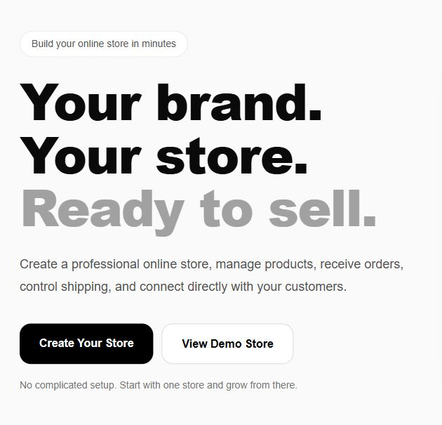
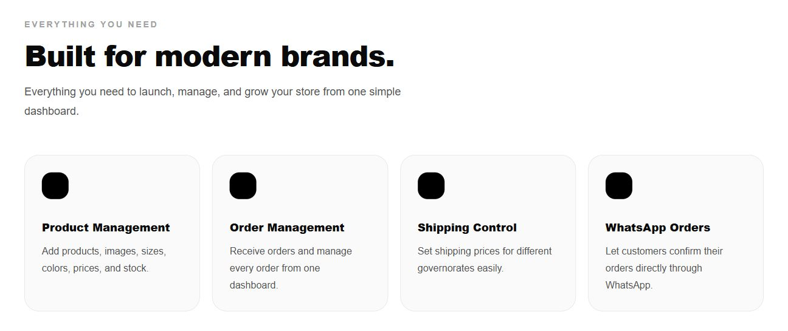
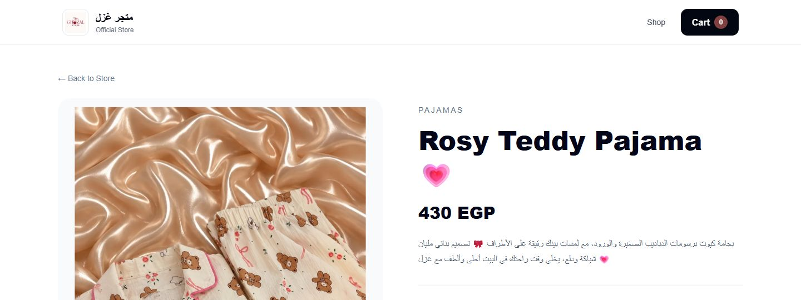
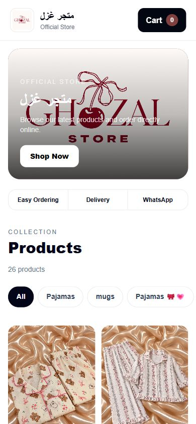

# Storeva

  

**Storeva helps small businesses in Egypt run an online storefront.** Merchants manage their catalog, shipping, and orders from one dashboard. Shoppers browse the store, place an order, and can send its details to the merchant on WhatsApp.

Subscription-based · No sales commissions · Private application source

[Official website](https://storeva.vercel.app/) · [Live customer storefront](https://storeva.vercel.app/ghazal) · [Architecture](#architecture) · [GitHub contact](#contact)

## The product

### Storeva homepage

  

### Ghazal · Live customer storefront

Ghazal is a real Storeva customer. Its public store shows how a merchant’s branding, product photography, and catalog appear to shoppers.

View the mobile storefront

  

## How it works

**Merchant journey.** Add product photos, prices, size and color variants, and stock quantities. Configure shipping rates by Egyptian governorate. Review incoming orders and update their status.

**Customer journey.** Browse the catalog, select a product option, and add it to the cart. Enter delivery details and review the shipping charge at checkout. After placing the order, open the prefilled WhatsApp message and send it to the merchant.

## Architecture

| Layer | Responsibility |
| --- | --- |
| Storefront | Next.js App Router serves store-specific catalog and product pages. React handles cart and checkout interactions. |
| Merchant dashboard | Signed-in merchants manage products, stock, delivery rates, and orders. |
| Data and media | Supabase Auth handles sign-in, PostgreSQL stores records, and Supabase Storage holds product images. |
| Order handoff | Checkout saves the order through a database function. The confirmation page opens a prefilled WhatsApp message at the shopper’s request. |

**Stack** · Next.js App Router, React, TypeScript, Tailwind CSS, Supabase, and Zustand with browser persistence for the cart.

## Contact

[Find Mohamed Mamdouh on GitHub](https://github.com/mohamedmamdouh1805) for portfolio inquiries.
